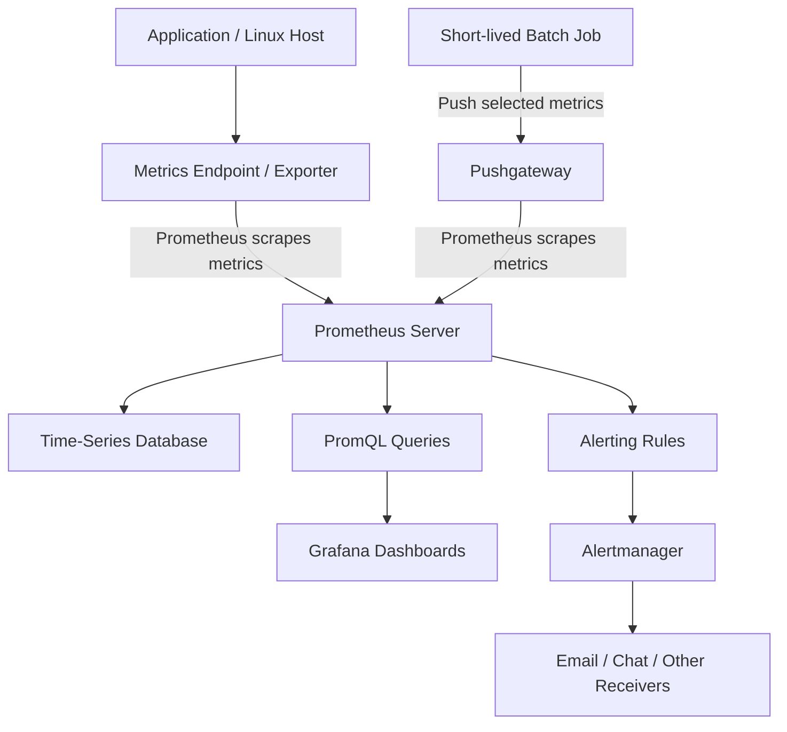

# Prometheus Fundamentals — Phase 1

## Introduction

In this phase, I learned the basics of Prometheus and how it helps monitor applications, servers, and infrastructure. I understood how metrics are collected and stored, how labels and time series work, and the different types of metrics. I also learned about the pull and push models, scrape intervals, jobs, targets, Prometheus architecture, and basic PromQL queries. This gave me a foundation for starting hands-on monitoring with Prometheus.

## Topics Covered

### 1. Introduction to Prometheus
- What Prometheus is and why it is used.
- Monitoring applications, servers, and infrastructure.
- Collecting, storing, and querying time-series metrics.

### 2. Metrics, Labels, and Time Series
- **Metrics:** Numerical measurements used to monitor systems.
- **Labels:** Key-value pairs used to filter and group metrics.
- **Time series:** Timestamped metric values identified by a metric name and label combination.
- **Cardinality:** The number of unique time series generated by metrics and labels.

Example:

```text
http_requests_total{method="GET", status="200"} 150
```

### 3. Prometheus Metric Types

| Metric Type | Purpose | Example |
|---|---|---|
| Counter | Tracks cumulative values that increase, except when reset | Total HTTP requests |
| Gauge | Tracks values that can increase or decrease | Memory usage |
| Histogram | Groups observations into buckets and records their count and sum | Request duration |
| Summary | Records observation count and sum, with optional client-side quantiles | Request latency |

### 4. Pull vs. Push Model
- **Pull model:** Prometheus periodically collects metrics by scraping targets.
- **Push model:** A client sends metrics to a receiving service.
- Prometheus primarily uses the pull model.
- Pushgateway can be used for selected short-lived batch jobs.

### 5. Scrape Interval
- Defines how frequently Prometheus collects metrics from targets.
- Configured using `scrape_interval`.
- Example: `scrape_interval: 15s` means Prometheus attempts to scrape every 15 seconds.

### 6. Jobs and Targets
- **Job:** A group of monitored endpoints with a common purpose.
- **Target:** An individual endpoint from which Prometheus collects metrics.
- Targets can be configured using `scrape_configs` and `static_configs`.

### 7. Prometheus Configuration

The main configuration file is `prometheus.yml`.

Important configuration fields:

- `global`: Defines global settings, such as the scrape interval.
- `scrape_configs`: Defines which targets Prometheus monitors.
- `job_name`: Identifies a group of scrape targets.
- `static_configs`: Specifies targets manually.
- `targets`: Contains endpoint addresses to scrape.

### 8. Prometheus Architecture Components
- **Prometheus Server:** Scrapes, stores, and queries metrics.
- **Exporters:** Expose metrics from systems and applications.
- **Pushgateway:** Receives metrics from selected short-lived jobs.
- **Alertmanager:** Handles alert grouping, routing, and notifications.
- **Grafana:** Visualizes metrics using dashboards.

## Prometheus Architecture Diagram



### 9. PromQL Fundamentals
- **PromQL:** The query language used to select and analyze Prometheus metrics.
- `up`: Checks whether a target was successfully scraped.
- **Label selectors:** Filter metrics based on label values.
- `rate()`: Calculates the per-second average increase of a counter over a specified range.

Examples:

Check target status:

```promql
up
```

Filter metrics using labels:

```promql
http_requests_total{method="GET"}
```

Calculate the request rate over five minutes:

```promql
rate(http_requests_total[5m])
```

## Key Takeaways

- Prometheus is a monitoring and alerting system designed for time-series data.
- Metrics represent measurements, while labels add dimensions to those measurements.
- Counters, gauges, histograms, and summaries serve different monitoring purposes.
- Prometheus primarily collects metrics using a pull-based scraping model.
- Exporters expose metrics for Prometheus to collect.
- PromQL helps query and analyze collected metrics.
- Grafana provides visualization, while Alertmanager manages alert notifications.
- Avoid unbounded label values to control time-series cardinality.
- Keep monitoring endpoints private and restrict access appropriately.

## Next Step — Phase 2: Hands-on Lab

- Run Prometheus using Docker Compose.
- Open the Prometheus UI on port `9090`.
- Verify the Prometheus target under **Status → Targets**.
- Add Node Exporter to collect Linux system metrics.
- Explore CPU, memory, disk, and network metrics.
- Understand and modify `prometheus.yml`.
